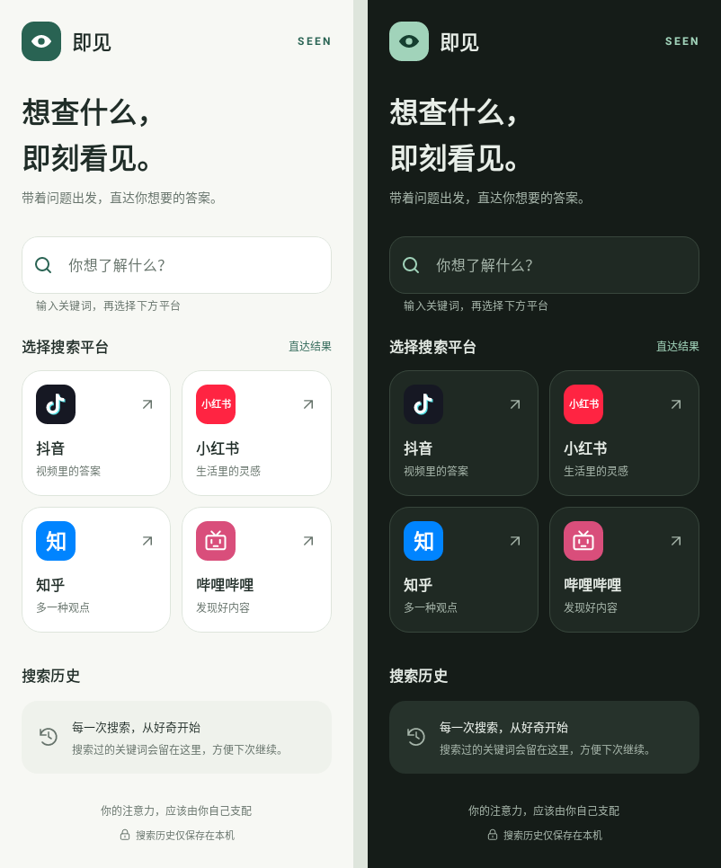

# 即见（Seen）

<p align="center">
  
  <br>所见即所得
</p>

一款极简的 Android 工具 App：**一个输入框直达抖音 / 小红书 / 知乎 / 哔哩哔哩的搜索结果页**，绕过打开 App 时的算法推荐流，避免「想搜 A，结果刷了半天 B」的分心问题。

> **你的注意力，应该由你自己支配。**
>
> 我们每一次打开这些 App，本意往往只是查一个东西。可打开的瞬间，推荐流早已等在那里——精心计算的标题、恰好在走神时出现的视频，于是一个「30 秒的搜索」变成了一小时的被动浏览。这不是你意志力不够，而是成百上千位工程师在优化「如何让你多停留一秒」。
>
> 注意力是我们最宝贵、也最有限的东西。Seen 的做法很简单：**在打开 App 之前，先完成搜索。** 输入你想查的，直达结果页，拿到答案就离开。不猜你喜欢什么，不为你准备下一条。

## 功能

- 🔍 统一搜索框，输入想查的内容
- 🎯 四平台一键直达（抖音 / 小红书 / 知乎 / 哔哩哔哩）
- 📺 B 站覆盖国内版、国际版、港澳台版（按包名精确唤起）
- 🕘 本地搜索历史（去重、最多 20 条、可清空、点击回填）
- 🎨 暖白 / 墨绿界面，跟随系统切换深色模式
- 🧩 双列平台卡片、空历史提示、长关键词省略显示并完整回填
- 🛡️ 清空历史前确认，空输入与无法打开平台时给出明确反馈

## 界面预览

以下为原生 Android 布局渲染的完整滚动内容，左侧为浅色，右侧为深色。



## 如何使用

1. 进入本仓库的 [Releases](https://github.com/HauUhang/Seen/releases) 页面，下载最新版本的 **APK 文件**。
2. 将 APK 传到自己的手机上（微信 / QQ / 数据线均可），点击安装；系统提示「允许安装未知来源应用」时选择允许。
3. 安装完成后桌面出现「即见」，打开 → 输入想查的内容 → 点对应平台，直达搜索结果页。

## 视频演示

本机环境：
- 抖音：已安装未登录
- 小红书：已安装已登录
- bilibili：国际版已登录
- 知乎：未安装为登录

https://github.com/user-attachments/assets/328718fc-f9aa-4376-9573-59d190ff64fd

## 打开策略

优先唤起已安装的 App 深链直达搜索页；未安装时降级为浏览器网页搜索。

| 平台   | 已安装 App（深链直达搜索页）                       | 未安装（浏览器网页搜索）                                   |
| ---- | -------------------------------------- | ---------------------------------------------- |
| 抖音   | `snssdk1128://search?keyword=`         | `https://www.douyin.com/search/`               |
| 小红书  | `xhsdiscover://search/result?keyword=` | `https://www.xiaohongshu.com/search_result`    |
| 知乎   | `zhihu://search?q=`                    | `https://www.zhihu.com/search?type=content&q=` |
| 哔哩哔哩 | `bilibili://search?keyword=`           | `https://search.bilibili.com/all?keyword=`     |

> 各平台深链 scheme 可能随版本调整，全部集中在 `Platform.kt`，一处修改即可。
>
> 深链唤起**不依赖 `resolveActivity` 预判**（Android 11+ 包可见性会误判「未安装」），而是直接 `startActivity` + try/catch，失败才降级网页。

### B 站多版本说明

B 站搜索按包名逐个尝试，命中即停：

| 顺序 | 目标           | 包名                    |
| -- | ------------ | --------------------- |
| 1  | 国内版          | `tv.danmaku.bili`     |
| 2  | 国际版 / 港澳台版   | `com.bilibili.app.in` |
| 3  | 通用兜底（任意已装版本） | 不指定                   |

## 技术栈

- Kotlin + AndroidX + Material3 + ViewBinding
- minSdk 26（Android 8.0+） / targetSdk 34
- AGP 8.13.2 / Gradle 8.13 / Kotlin 1.9.24（JDK 17）

> 若 Android Studio 提示升级 AGP，按提示更新即可，不影响代码逻辑。

## 本地构建与检查

使用 JDK 17 或更高版本，在 Android Studio 中安装 Android SDK Platform 34 和 Build Tools 35.0.0。通过 SDK 设置或本机 `local.properties` 的 `sdk.dir` 指定 SDK 路径。

Windows：

```powershell
.\gradlew.bat :app:assembleDebug :app:lintDebug :app:testDebugUnitTest
```

macOS / Linux：

```bash
bash ./gradlew :app:assembleDebug :app:lintDebug :app:testDebugUnitTest
```

- 测试版安装包：`app/build/outputs/apk/debug/app-debug.apk`。
- 交互测试报告：`app/build/reports/tests/testDebugUnitTest/index.html`。
- 原生布局渲染：`app/build/reports/ui/`，覆盖浅色、深色、320dp 窄屏和 800dp 平板。
- 自动检查覆盖四平台入口、空输入、历史回填、清空确认、输入恢复与网页降级。第三方 App 的实际搜索落点仍需在安装对应 App 的真机上验证。

界面配色集中在 `res/values/colors.xml` 与 `res/values-night/colors.xml`，平台卡片共用 `res/layout/item_platform.xml`。历史记录沿用原有存储格式。

本轮 UI 优化基于 `main` 分支的 `4aa65ae`，改动保存在本地工作区。2026-10-30 验证结果：Debug 构建通过，12 项自动测试通过，Lint 无错误；仍有 36 条非阻断提示，涉及依赖版本、未引用资源、绘制和代码风格。已人工查看浅色、深色、窄屏和平板渲染图，尚未在真机验证第三方 App 搜索落点、软键盘和读屏操作。

## 项目结构

```
JusouApp/
├── app/src/main/
│   ├── AndroidManifest.xml
│   ├── java/com/jusou/app/
│   │   ├── MainActivity.kt          # 界面与交互
│   │   ├── Platform.kt              # 四平台深链/网页地址（DeepLink 含包名机制）
│   │   ├── SearchEngine.kt          # 深链优先 + 网页降级
│   │   └── SearchHistoryManager.kt  # 历史记录持久化
│   └── res/
│       ├── layout/activity_main.xml
│       ├── values/  (strings / colors / themes)
│       ├── drawable/ (图标与形状)
│       └── mipmap-anydpi-v26/ (自适应图标)
```

## 已知限制

- 小红书、B 站等平台的 App 搜索结果页可能要求登录态；深链已命中 App，但未登录时可能停在首页或登录页，属平台行为。
- 未申请任何运行时权限，不联网、不采集数据，历史仅存本机。
